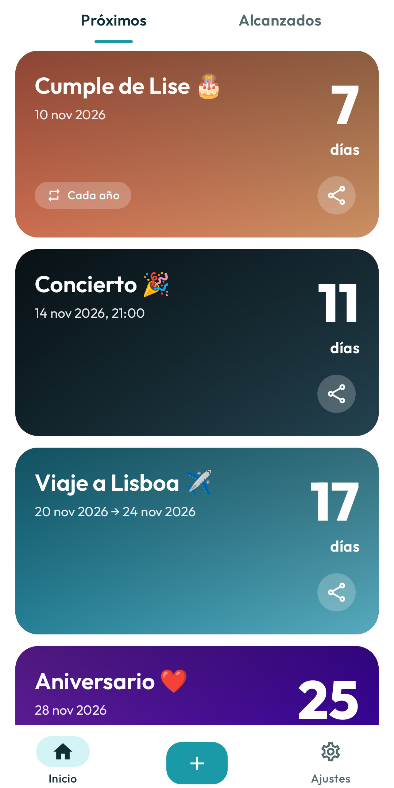
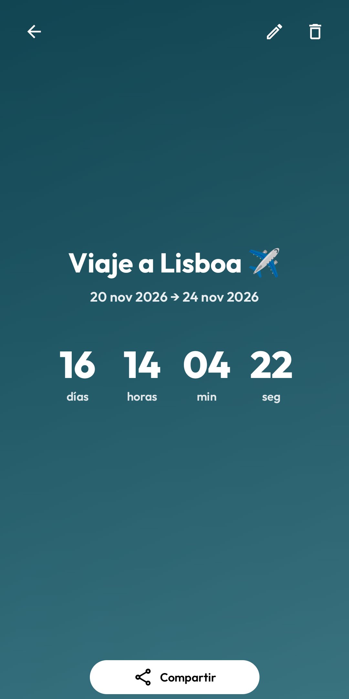
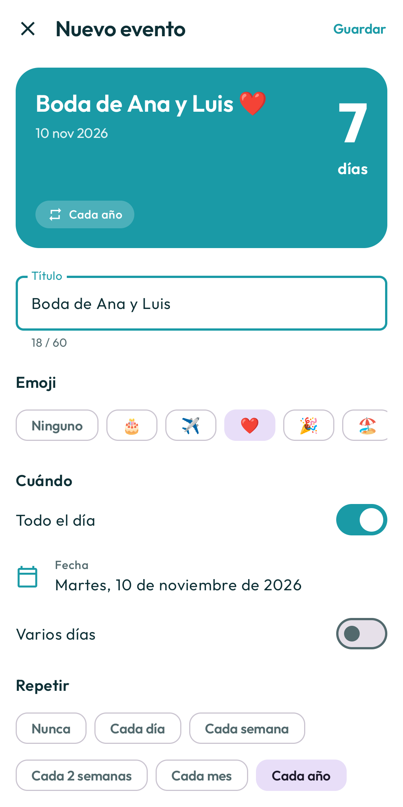
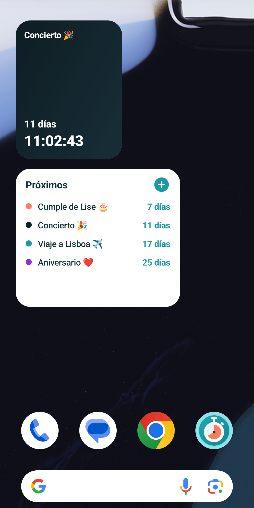
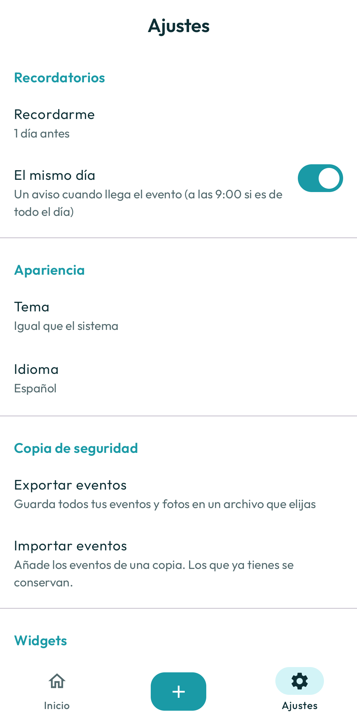

# Countdown to Event

App de Android para contar los días que faltan para lo que te ilusiona: cumpleaños, viajes,
conciertos, reencuentros… Con widgets para la pantalla de inicio y recordatorios.

Sin anuncios, sin cuentas y sin internet: todo se guarda en tu teléfono.

<p align="center">
  
  
  
  
  
</p>

## Pruébala

Descarga el APK desde [`demo/CountdownToEvent-1.0.0.apk`](demo/CountdownToEvent-1.0.0.apk) e instálalo
en tu teléfono (Android 8.0 o superior). Android te pedirá permitir la instalación de apps de
fuentes desconocidas.

## Funciones

- **Eventos:** título, emoji, fecha y hora, eventos de todo el día y de varios días.
- **Repetición:** diaria, semanal, quincenal, mensual o anual (ideal para cumpleaños).
- **Próximos y Alcanzados:** los eventos pasados se mueven solos de pestaña.
- **Fondos:** colores, degradados o una foto tuya.
- **Cuenta en vivo:** días, horas, minutos y segundos en la pantalla de detalle.
- **Widgets:** un evento (pequeño o grande, con modo en vivo) y lista de próximos eventos.
- **Recordatorios:** 15 min, 1 h, 1 día o 2 días antes, y aviso el mismo día.
- **Compartir:** como imagen (1080×1350) o como texto.
- **Copia de seguridad:** exporta e importa tus eventos en JSON, con fotos incluidas.
- **Modo oscuro**, español e inglés, y soporte de TalkBack y texto grande.

## Tecnología

- Kotlin + Jetpack Compose (Material 3)
- MVVM con `StateFlow` y Hilt
- Room (eventos) y DataStore (ajustes)
- Jetpack Glance (widgets) y AlarmManager + WorkManager (recordatorios)
- Coil (imágenes)
- minSdk 26 (Android 8.0), targetSdk 36

```
app/src/main/java/com/revsystems/countdowntoevent/
 ├─ ui/             pantallas, componentes y tema
 ├─ domain/         modelos y lógica (cuenta regresiva, repetición, validación)
 ├─ data/           Room, DataStore, imágenes y copias de seguridad
 ├─ widget/         widgets de pantalla de inicio
 ├─ notifications/  recordatorios
 └─ di/             módulos de Hilt
```

## Compilar

Necesitas JDK 17 y el SDK de Android (o Android Studio).

```sh
./gradlew assembleDebug        # APK de prueba
./gradlew testDebugUnitTest    # pruebas unitarias
./gradlew ktlintCheck          # estilo de código
```

El APK de prueba queda en `app/build/outputs/apk/debug/`. Se instala como
`com.revsystems.countdowntoevent.debug`, así que puede convivir con la versión de la tienda.

### Versión de release

La versión de release se firma con la clave de subida, que no está en el repositorio.
Copia `keystore.properties.example` a `keystore.properties` y rellena los datos de tu clave.

```sh
./gradlew assembleRelease   # APK firmado → app/build/outputs/apk/release/
./gradlew bundleRelease     # AAB para Google Play → app/build/outputs/bundle/release/
```

## Documentación

- [`PLAN.md`](PLAN.md): plan del proyecto y estado de cada tarea
- [`docs/RELEASE.md`](docs/RELEASE.md): cómo publicar en Google Play
- [`docs/play-store/listing.md`](docs/play-store/listing.md): textos de la ficha de la tienda
- [`docs/privacy/`](docs/privacy/index.html): política de privacidad

## Próximamente (v2)

Amigos, eventos compartidos y sincronización en tiempo real, con inicio de sesión de Google.
